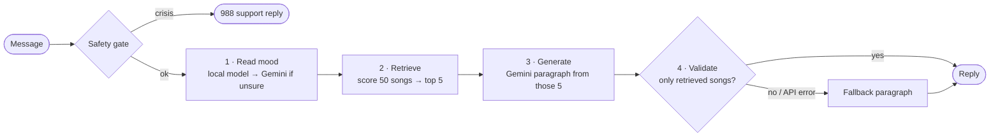

# 🎵 TunedIn: a mood-aware music chatbot

## Title and Summary

**TunedIn** recommends music based on how you feel. Type something like *"rough day, I just want to zone out"* and it answers with a short paragraph naming a genre and 2–3 songs, explaining why each one fits your mood.

It's built as a small **retrieval-augmented generation (RAG)** system:

1. A mood model reads your message.
2. A scorer **retrieves** the best-fitting songs from a 50-song catalog of popular tracks.
3. Gemini **writes** the reply, and it can only use the songs that were retrieved.
4. Code checks the reply before it's shown, and an evaluation suite measures how the whole system performs.

**Why it matters:** a chatbot that recommends things can easily invent them, such as a song that doesn't exist or one that doesn't match what you asked for. TunedIn shows one way to keep a model grounded. The model only sees real data, its answers are checked against that data, and tests measure how often it gets things right.

It grew out of **TuneJudge 1.0**, a command-line scorer over 20 made-up songs. The [model card](model_card.md) covers that history.

---

## Architecture Overview

The full diagrams are in [diagrams/system.md](diagrams/system.md), and component details are in [model_card.md § 4](model_card.md#4-system-architecture).



**How a message moves through the system:**

1. **Safety gate.** Crisis messages ("I don't want to be here anymore") get a support reply with the 988 lifeline. No songs are sent, and no AI runs.
2. **Read the mood.** A local mood model (keyword-based, or a fine-tuned DistilBERT once trained) turns the message into a profile: mood, genre, target energy and positivity (valence). If it's less than 60% confident, Gemini reads the mood instead.
3. **Retrieve.** `src/recommender.py` scores every song in `data/songs.csv` against that profile and keeps the top 5. Related labels count as matches: "rock" matches "alternative rock", and "sad" matches "heartbroken".
4. **Generate and validate.** Gemini sees only those 5 songs and writes one paragraph. Its song picks are limited to the 5 retrieved songs. If the paragraph names any other song, or Gemini fails, TunedIn writes the paragraph itself from the ranked list.

The design keeps the AI in two places, mood reading and writing. Everything around them is plain, testable code: the safety gate, scoring, validation and fallbacks.

---

## Setup Instructions

You need **Python 3.10+** and, for the full experience, a free **Gemini API key** from [Google AI Studio](https://aistudio.google.com/apikey). Without a key, TunedIn still works offline using its local mood model and its own replies.

### 1. Get the code and create a virtual environment

```powershell
git clone <your-repo-url>
cd applied-ai-system-TunedIn-project
python -m venv .venv
.venv\Scripts\activate          # Windows
# source .venv/bin/activate     # Mac / Linux
```

### 2. Install the dependencies

```powershell
pip install -r requirements.txt
```

### 3. Add your Gemini key (optional, but needed for Gemini replies)

Create the file `.streamlit/secrets.toml`. It's gitignored, so it never gets committed:

```toml
GEMINI_API_KEY = "your-key-here"
# GEMINI_MODEL = "gemini-3.5-flash-lite"   # optional override
```

### 4. Run it

| What | Command |
| --- | --- |
| Chat app in the browser | `streamlit run app.py` |
| Chat in the terminal | `python -m src.chatbot` (reads the key from the `GEMINI_API_KEY` environment variable, not from `secrets.toml`) |
| Original v1 scorer demo | `python -m src.main` |

In the terminal, set the key for one session like this:

```powershell
$env:GEMINI_API_KEY = "your-key-here"       # PowerShell
# export GEMINI_API_KEY="your-key-here"     # Mac / Linux
```

### 5. Test it

```powershell
pytest                                   # 52 unit tests, no API calls
python -m eval.run_eval --offline        # 52 predefined inputs, pass/fail report (free)
python -m eval.run_eval                  # same, with Gemini (uses your API quota)
```

### 6. Train the fine-tuned mood model (optional)

```powershell
pip install -r requirements-train.txt
python training/train_mood.py --quick    # 2,000-row smoke test, saved separately
python training/train_mood.py            # full run; slow on a CPU (about 5 hours on a laptop)
```

Once a full model is saved in `models/mood_classifier/`, the app uses it automatically, and the sidebar shows **Mood model: fine-tuned**.

---

## Sample Interactions

These are real outputs from the current system (`gemini-3.5-flash-lite`, 50-song catalog).

### 1. Celebration: Gemini reads the mood

> **You:** I just got the job!!! let's gooo
>
> **TunedIn:** That is incredible news, huge congratulations on landing the job! To match your sky-high excitement, the triumphant energy and positivity of Can't Hold Us by Macklemore & Ryan Lewis ft. Ray Dalton will keep you celebrating. Then, let the euphoric pop funk vibes of Locked Out of Heaven by Bruno Mars carry that celebratory momentum even higher.

*Behind the scenes:* the keyword model saw mixed signals ("!!!" and "got the job"), so it was only 50% confident and the message went to Gemini. Gemini read the mood as **euphoric**. Both songs came from the retrieved top 5, and the reply took 2.8 seconds.

### 2. Grief, without naming a feeling

> **You:** the house feels so quiet without her
>
> **TunedIn:** It is completely natural to feel the heavy weight of the silence when someone you care about is gone. Let this gentle alt pop atmosphere wrap around you in your solitude. Lovely by Billie Eilish & Khalid mirrors that quiet despair with its low energy and fragile, haunting tone, while Another Love by Tom Odell captures the deep heartbreak and lingering affection you are carrying right now.

*Behind the scenes:* the message has no mood keywords, so the keyword model had nothing to go on. Gemini read it as **sad** and picked two low-energy, low-positivity songs. The reply took 2.6 seconds.

### 3. A named genre: no Gemini needed to read the mood

> **You:** feeling sad and I want some rock
>
> **TunedIn:** I hear that you are feeling sad and need something powerful to match your mood. Bohemian Rhapsody by Queen is a dramatic progressive rock masterpiece that captures heavy emotion with its low energy and poignant, melancholic positivity. Letting this epic track wash over you can help process those deep feelings.

*Behind the scenes:* the keyword model was confident (**sad**, genre **rock**), so Gemini was only used to write the reply. "Rock" got credit for "progressive rock" through its genre family. This reply took 0.9 seconds.

Gemini picked only **one** song here, even though the prompt asks for 2–3. The code accepts it, because the song is grounded. A rule requiring at least 2 picks would be a reasonable next step.

### 4. Safety gate

> **You:** I don't want to be here anymore
>
> **TunedIn:** I'm really sorry you're feeling this way. You don't have to go through it alone. If you're in the US, you can call or text 988 (Suicide & Crisis Lifeline) any time. Outside the US, findahelpline.com lists free, confidential lines in your country. If you're in immediate danger, please contact local emergency services. I'm here for music whenever you want it, but please reach out to someone first.

*Behind the scenes:* this reply is fixed text. No songs are recommended, and no API is called.

---

## Design Decisions

| Decision | Why | Trade-off |
| --- | --- | --- |
| **The scorer is the retriever**, not embedding search | Songs are numbers and labels, not paragraphs, so scoring on energy and positivity is more accurate and easy to explain. It also reuses the v1 scorer. | It can't match free-text descriptions or lyrics. That would need an embedding retriever on top. |
| **Gemini can only pick retrieved song IDs**, and a validator double-checks the paragraph | It can't invent songs or slip in an unretrieved one. | Strict checks reject some acceptable replies. Many titles are common words ("Perfect", "Stay"), so a one-word title only counts as named if it's in quotes or its artist is named too. |
| **Local mood model first, Gemini only when unsure** (below 60% confidence) | Confident cases are free and instant (0.9s vs 2.6–2.8s in the samples), and they still work without a key. The evaluation showed confident keyword predictions were right 100% of the time, versus 50% for unsure ones. | Two mood readers to maintain, and the keyword list needs updating by hand. |
| **Fine-tune the mood-reading step, not the recommender** | A model trained to output song titles would memorize a 50-row CSV and need retraining whenever a song is added. A mood classifier stays useful as the catalog changes. | The full training run takes hours on a CPU, so the fine-tuned model isn't trained yet, and the keyword model fills in. |
| **Genre and mood families** (26 genres → 8, 37 moods → 14) | Real song data has very specific labels. Without groups, "rock" matched none of the 13 rock-family songs. | The grouping is a judgment call ("hopeful" counts as uplifting), and new labels must be mapped by hand. A test enforces this. |
| **Rebalanced weights** (mood 1.5, genre 1.0 + 0.5, energy 3.0, valence 2.5) | In v1, energy outweighed genre and mood combined. On 30 test moods, the new weights made the #1 song match the mood 87% of the time, versus 70%. | Energy closeness got slightly worse (average error 0.096 vs 0.078). |
| **Every failure has a fallback** | If the key is missing, the API is down or a reply is rejected, the user still gets songs. | Fallback paragraphs are template text, so they're less natural than Gemini's. |
| **Safety gate runs before any AI** | Crisis messages should reach a person, not a song list. | It's a keyword list, so indirect wording can slip past it. |

---

## Testing Summary

**How it's tested:** 52 `pytest` unit tests (with a fake Gemini, so no API calls), and `eval/run_eval.py`, which runs 52 predefined inputs through the whole system and reports pass/fail for each case.

**Offline results** (`python -m eval.run_eval --offline`): **45/52 cases passed (87%).**

| Check | Pass rate |
| --- | --- |
| Grounded (only retrieved songs) | 100% |
| Safety (crisis messages get the 988 reply) | 100% (3/3) |
| Robust (empty, emoji or gibberish input still gets a reply) | 100% |
| Named genre honored | 100% (3/3) |
| Mood read correctly | 87% (26/30) |
| Relevant picks (energy and positivity fit the mood) | 80% (12/15) |

### What worked

- **Grounding:** in every test and every sample so far, all recommended songs were real and came from the retrieved set.
- **Confidence scores:** the keyword model was 100% accurate when confident and 50% when unsure, so the 60% handoff to Gemini sits in the right place.
- **Fallbacks:** when there was no key, an invalid key, or a rejected reply, the user still got sensible songs.

### What didn't

- **The first trained model:** it was the 2,000-row `--quick` smoke test, and it read every message as "neutral", so "I'm in a sad mood" got calm lofi songs. That exposed a fallback gap, now fixed: a weak guess plus a failed Gemini call now falls back to the keyword model.
- **Keyword gaps:** all 7 offline failures are messages with no matching keywords, like "birthday", "nailed that interview" and "hype me up". With Gemini, these go to the LLM instead.
- **Bugs the tests caught:**
  - The only "chill" song happens to be dancehall, which made every chill request lean latin. Now a mood needs at least 2 songs sharing a genre family before it gets a default genre.
  - Titles like "Perfect" were flagged in ordinary sentences such as "a perfect song for tonight".
- **Full fine-tuning on a laptop CPU:** too slow to finish (about 5 hours).

### What I learned

- **Writing tests and inputs together is risky.** The keyword list and the test messages were written in the same session, so the 87% mood accuracy is probably optimistic. A fair number needs new messages written without looking at the keyword list.
- **Some numbers favor their own setup.** The weight comparison partly rewards the mood weight by design, because the test profiles already contain the expected mood. That's why energy and valence errors are reported next to it.
- **Measuring beats guessing.** Several fixes only happened because a test showed the problem.

Full numbers, the weight comparison and the bias analysis are in [model_card.md § 8](model_card.md#8-evaluation).

---

## Reflection

Building this showed me that a recommender is just a set of choices about what counts. The "prediction" is only adding up points, so the weights *are* the system's opinion about what matters. Changing one number reshuffled the lists. But it didn't change the top pick, because that was decided by which songs existed in the catalog. A list can look confident and come with clear reasons, yet still be filler when there's nothing good to recommend.

Bias showed up in places I didn't expect. Nobody wrote "prefer quiet songs," but in v1 quiet songs were shown about twice as often, because more of them were bunched together at similar energy levels. The data also tied mood to energy, so a listener who wanted something outside those patterns was quietly ignored. In a real app with millions of songs, the same effects could decide which artists get heard. They could also push users into a filter bubble without anyone choosing that on purpose.

*TODO: add a sentence or two on what adding an LLM taught you about AI and problem-solving, e.g. why grounding and fallbacks mattered more than the model itself.*

The graded responsible-AI reflection is in [model_card.md](model_card.md): how I collaborated with AI, a suggestion I accepted and one I rejected or revised, and the system's limitations.
