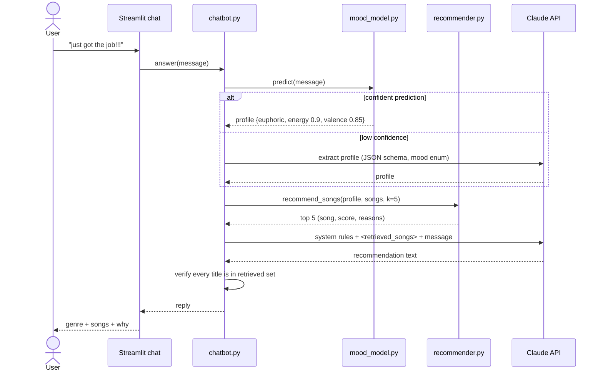
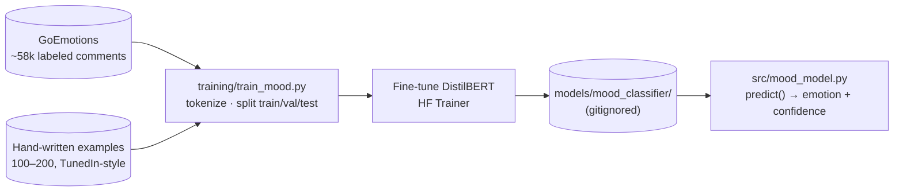
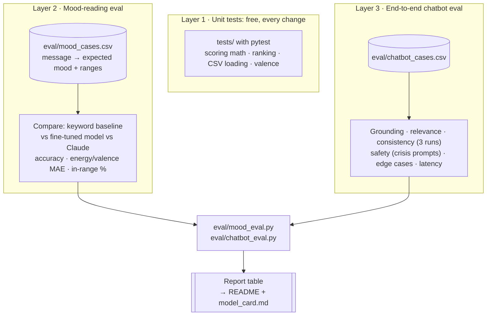

# TunedIn System Architecture

TunedIn is a mood-aware music chatbot. It reads how a user feels, retrieves
matching songs from `data/songs.csv`, and writes a recommendation grounded only
in those retrieved songs (Retrieval-Augmented Generation).

**Legend:** everything below is built. The fine-tuned classifier needs one training run
(`python training/train_mood.py`); until then the keyword baseline fills that slot.

---

## 1. System overview

```mermaid
flowchart LR
    U([User message<br/>"rough day, need to zone out"])

    subgraph UNDERSTAND["1 · Understand mood"]
        FT["Fine-tuned emotion classifier<br/>DistilBERT on GoEmotions<br/>(keyword baseline until trained)"]
        MAP["Emotion → profile map<br/>mood, target_energy,<br/>target_valence, likes_acoustic"]
        CL1["Claude fallback<br/>structured JSON profile"]
        FT -->|confidence ≥ threshold| MAP
        FT -.->|low confidence / error| CL1
    end

    subgraph RETRIEVE["2 · Retrieve"]
        CSV[("data/songs.csv")]
        SC["score_song + recommend_songs<br/>genre · mood · energy · acoustic<br/>+ valence"]
        CSV --> SC
    end

    subgraph GENERATE["3 · Generate"]
        CL2["Claude reply<br/>uses ONLY retrieved songs"]
        GUARD["Grounding check<br/>titles must exist in retrieved set"]
        CL2 --> GUARD
    end

    U --> FT
    MAP --> SC
    CL1 --> SC
    SC -->|top-k songs + reasons| CL2
    GUARD --> R([Reply: genre + 2–3 songs<br/>+ why each fits])
    SC -.->|API down: plain ranked list| R
```

---

## 2. Request flow



---

## 3. Fine-tuning pipeline



---

## 4. Reliability & testing



Layers 2 and 3 call the Claude API and cost money per run. Run them when
prompts, the model, or the catalog change. Layer 1 never calls the API.

---

## Components

| Component | File | Status | Role |
| --- | --- | --- | --- |
| Song catalog | `data/songs.csv` | built | Knowledge base for retrieval |
| Scorer / retriever | `src/recommender.py` | built (with valence) | Ranks songs against a mood profile |
| CLI runner | `src/main.py` | built | Prints ranked results for fixed profiles |
| Mood classifier | `src/mood_model.py` | built (keyword + fine-tuned loader) | Fine-tuned text → emotion + confidence |
| Training script | `training/train_mood.py` | built, not yet run | Fine-tunes DistilBERT |
| Chatbot pipeline | `src/chatbot.py` | built | Understand → retrieve → generate, with fallbacks |
| Chat UI | `app.py` (Streamlit) | built | User-facing chat |
| Evals | `eval/` | built | Layers 2–3 and report |
