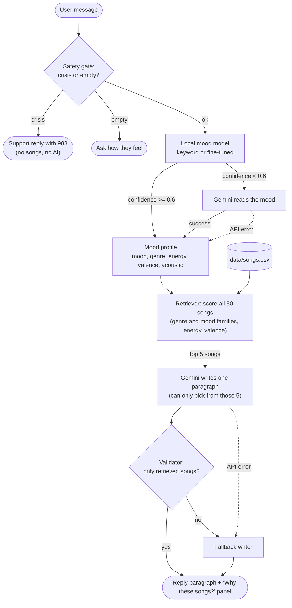

# 🎧 Model Card: TunedIn

## 1. Model Name

**TunedIn 2.0**, a mood-aware music chatbot. It grew out of **TuneJudge 1.0**, a command-line scorer (see [Version history](#11-version-history)).

---

## 2. Goal and Intended Use

### Goal / Task

You tell TunedIn how you feel in your own words ("rough day, I just want to zone out"). It works out your mood, finds matching songs in its catalog, and answers with a short paragraph naming a genre and 2–3 songs, with the reason each one fits.

### Intended use

- Classroom project for learning retrieval-augmented generation (RAG), fine-tuning and evaluation.
- Trying out how mood reading, scoring weights and catalog design change recommendations.

### Not intended for

- Real users in distress. Crisis detection is a keyword list, not a safety system (see section 7).
- Judging what music is "good." It only measures fit with a mood.
- A real music service. The catalog has 50 songs.

---

## 3. How the Model Works

Three steps run for each message:

1. **Read the mood.** A local mood model guesses the emotion first:
   - **Keyword model:** matches about 150 mood words, then sets a target energy and positivity (valence) for that emotion. It also picks a genre: one you name ("some rock"), or else the catalog's usual genre for that mood.
   - **Fine-tuned model (optional):** DistilBERT trained on GoEmotions (about 58k labeled comments). It replaces the keyword model once trained.
   - **Gemini:** if the local model is less than 60% confident, Gemini (`gemini-3.5-flash-lite`) reads the mood instead.
2. **Retrieve songs.** Every song gets points for fitting the mood, and the top 5 go to the next step:

   | Component | Points |
   | --- | --- |
   | Same genre family (e.g. "rock" vs "alternative rock") | +1.0 |
   | Exact subgenre (bonus) | +0.5 |
   | Same mood family (e.g. "sad" vs "heartbroken") | +1.5 |
   | Energy closeness | up to +3.0 × (1 − \|energy − target\|)² |
   | Positivity (valence) closeness | up to +2.5 × (1 − \|valence − target\|)² |
   | Acoustic fit | up to +0.5 |

   The maximum is 9.0. Matching ignores capital letters.
3. **Write the reply.** Gemini sees only those 5 songs and writes one short paragraph. Code checks the reply before showing it:
   - Gemini can only pick song IDs from the 5 retrieved songs.
   - If the paragraph names any other catalog song, the reply is rejected.
   - If Gemini fails or is rejected, TunedIn writes the paragraph itself from the ranked list.

**Safety checks run first.** Crisis messages (such as "I don't want to be here anymore") get a support message with the 988 lifeline, with no songs and no API call. An empty message gets a prompt to share how you feel.

---

## 4. System Architecture

### Main components

| Component | File | What it does | Uses AI? |
| --- | --- | --- | --- |
| **Chat interface** | `app.py` | Takes the user's message. Shows the reply and a "Why these songs?" panel. | No |
| **Orchestrator** | `src/chatbot.py` (`TunedInBot.answer`) | Runs the steps below in a fixed order and decides when to fall back. | No |
| **Safety gate** | `src/chatbot.py` (`is_crisis`) | Catches crisis and empty messages before any AI runs. | No |
| **Mood reader** | `src/mood_model.py`, `src/llm.py` | Turns the message into a mood profile with a confidence score. Uses the keyword model or fine-tuned model first, and Gemini when they're unsure. | Yes |
| **Catalog normalizer** | `src/catalog.py` | Groups 26 genres and 37 moods into families, so related labels match. | No |
| **Retriever** | `src/recommender.py` | Scores all 50 songs against the mood profile and keeps the top 5. This is the "R" in RAG. | No |
| **Generator** | `src/llm.py` (`GeminiLLM`) | Gemini writes the reply paragraph using only the 5 retrieved songs. | Yes |
| **Validator** | `src/chatbot.py` (`mentioned_titles`) | Rejects any reply that picks or names a song outside the retrieved set. | No |
| **Fallback writer** | `src/chatbot.py` (`_fallback_paragraph`) | Writes the paragraph from the ranked list when Gemini fails or is rejected. | No |
| **Evaluator** | `eval/run_eval.py` | Runs 52 predefined inputs and prints pass/fail results and confidence ratings. | Runs the AI |
| **Tester** | `tests/` | 52 `pytest` unit tests. They use a fake Gemini, so they cost nothing and need no key. | No |

**There is no agent.** The steps always run in the same order, and code (not the AI) decides when to fall back. The AI never plans its own steps or picks its own tools.

### How data flows through the system

**Input:** one message in the user's own words, such as "rough day, I just want to zone out."

**Process:**

1. **Safety gate.** If the message is a crisis, the support reply is sent and nothing else runs. An empty message gets a prompt to share how they feel.
2. **Read the mood.** The local model guesses the emotion and how confident it is.
   - At 60% or more, its guess is used.
   - Below that, Gemini reads the mood instead.
   - If Gemini fails, the bot uses the keyword model's guess.
   - The result is a profile: mood, genre, target energy, target positivity (valence) and acoustic preference.
3. **Retrieve.** Every song in `data/songs.csv` gets a score against the profile, and the top 5 are kept.
4. **Generate.** Gemini gets the message and only those 5 songs. It returns a genre, the IDs of the songs it picked, and one paragraph. The song IDs are restricted to the 5 retrieved songs.
5. **Validate.** Code checks that the paragraph names no song outside the picks. If it passes, the paragraph is used. If it fails, or Gemini errored, the fallback writer builds the paragraph from the ranked list instead.

**Output:** a paragraph naming a genre and 2–3 songs, plus the details shown in the "Why these songs?" panel:
- how the mood was read, which model read it, and its confidence,
- the full profile,
- any warnings,
- how long the reply took.

### Where humans and testing check the AI

**Before the system runs (people set the ground truth):**

- **Labeled test cases:** people wrote the expected answers in `eval/mood_cases.csv` (30 messages) and `eval/chatbot_cases.csv` (23 messages). Every automatic check compares the AI's results against these.
- **Training examples:** people wrote the 40 examples in `training/custom_examples.csv`, and kept them separate from the test messages.
- **Genre and mood families:** people grouped the labels in `src/catalog.py`. A test fails until a new genre or mood is grouped.
- **Weights:** a person chose the scoring weights by comparing three sets on the test cases (section 8).

**While it runs (automatic checks on every message):**

- **Safety gate:** crisis messages go to human help (the 988 line), not to the AI.
- **Confidence check:** when the local model is unsure, the message goes to Gemini.
- **Output schema:** Gemini's reply must follow a fixed format, and its song picks are limited to the 5 retrieved songs.
- **Validator:** code rejects any reply that names a song outside the picks, and the fallback writer takes over.
- **The user:** the "Why these songs?" panel shows how the mood was read, by which model, and how confident it was. Users can see when the system misread them.

**After changes (testing):**

- **Unit tests:** 52 `pytest` tests run on every change, with no API calls.
- **Evaluation runner:** `python -m eval.run_eval` runs all 52 predefined inputs. It prints pass/fail for each case, pass rates for each check, and whether high confidence actually means higher accuracy. `--min-pass 0.8` makes it fail (exit code 1) below 80%, so it can block a bad change.
- **Reviewing failures:** a person reads the failures (`-v` prints the replies) and decides what to fix. This review found the "every chill request leans latin" bug and the keyword gaps described in section 7.

**Gaps:**

- **No human review of live replies.** Nobody checks Gemini's replies to real users as they happen.
- **No feedback button.** Users can't mark a recommendation as good or bad.
- **Basic crisis detection.** It's a keyword list (see section 7).

---

## 5. Data

### Song catalog (`data/songs.csv`)

- **50 popular songs**, from "Blinding Lights" to "Bohemian Rhapsody." Each has genre, mood, energy, tempo, valence, danceability and acousticness.
- **Source:** _TODO: say where the songs and audio features came from (e.g. a Kaggle dataset name and link, or Spotify's API before its November 2024 changes), the license, and who chose the mood labels._
- **Specific labels are grouped into families** (`src/catalog.py`):
  - 26 genres become 8 families: pop, rock, metal, hip-hop, r&b, electronic, folk, latin.
  - 37 moods become 14 mood families. For example, "heartbroken" and "despairing" both count as "sad."
  - A test fails if a new song uses a genre or mood that isn't mapped.

**Songs per family:**

| Genre family | Songs | Mood family | Songs |
| --- | --- | --- | --- |
| pop | 20 | romantic | 7 |
| rock | 13 | melancholy | 6 |
| r&b | 4 | nostalgic, moody | 5 each |
| hip-hop | 4 | intense | 4 |
| electronic | 4 | happy, sad, playful, uplifting, confident, euphoric, angry | 3 each |
| latin | 2 | chill, energetic | 1 each |
| folk | 2 | | |
| metal | 1 | | |

### Mood-reading data

- **Fine-tuning:** GoEmotions (Google Research), plus 40 hand-written examples in `training/custom_examples.csv`.
- **Evaluation:** 30 hand-labeled messages in `eval/mood_cases.csv`. They're kept separate from the training examples.

### Limits of the data

- **Pop-heavy:** 40% of the songs are pop and 26% are rock. There's one metal song and no jazz, classical, country or blues.
- **Few quiet songs:** only 5 have energy below 0.4, and only 3 have energy above 0.85.
- **Thin moods:** "chill" and "energetic" have one song each.
- **Mood labels can disagree with the audio features.** "Perfect" is labeled romantic but has valence 0.17, which Spotify-style data reads as sad-sounding.
- **No lyrics, language, or listening history.**

---

## 6. Strengths

- **Grounded replies:** in every test so far, every song in a reply came from the catalog and from that request's retrieved songs. Gemini can't invent songs.
- **Keeps working without Gemini.** If the API is down or there's no key, it still returns songs, using the keyword model and its own paragraph.
- **Related genres now count.** Asking for "rock" credits "alternative rock," and "rap" finds hip-hop.
- **Capital letters don't matter.** "Pop" now matches "pop," fixing a v1 bug.
- **Explains itself.** Each pick has scoring reasons, and the app shows how the mood was read.

---

## 7. Limitations and Bias

- **Crisis detection is basic.** It's a short list of phrases, so indirect wording can slip past it. It's a guardrail for a class project, not a substitute for real safety tooling.
- **Quiet songs get over-shown.** In a test with 5,000 random listeners:
  - Each song's fair share was 500 appearances.
  - "When I Was Your Man" appeared 1,080 times (2.2×), and "Love Yourself" and "Lovely" about 1.7× each. With so few quiet songs, they win every low-energy request.
  - Mid-energy songs compete with many others, so some barely appear: "Counting Stars" 85 times (0.17×), "Heat Waves" 108 (0.22×).
- **Genre exposure follows the catalog.** Pop is 40% of songs and 42% of what's shown, and rock is 26% and 22%. So pop gets more chances simply because there's more of it.
- **The keyword model has gaps.** It has no words for "birthday" or "hype me up," for example, so it reads them as neutral. In the app these low-confidence cases go to Gemini; offline they get calm songs.
- **Defaults are skipped for thin moods.** A mood only gets a default genre if at least 2 of its songs share a genre family, because one song shouldn't decide a whole mood.
- **Privacy:** messages describe how someone feels and are sent to Google's Gemini API. Google's free tier may use prompts to improve its products; paid-tier keys are not used that way. Users should know this before sharing anything personal.

---

## 8. Evaluation

Run everything at once with `python -m eval.run_eval --offline` (52 predefined inputs, pass/fail per case, confidence ratings). Offline it passes 45/52 (87%). When the keyword model is confident (>= 0.6), it reads the mood correctly 100% of the time (22 cases); when unsure, 50% (8 cases).

### Unit tests

52 `pytest` tests pass, with no API calls. They cover scoring, genre and mood families, the mood models, provider setup, fallbacks, grounding, title matching, crisis handling, checks that every catalog genre and mood is mapped, and the evaluation runner itself.

### Mood reading (`python -m eval.mood_eval`)

| Model | Mood accuracy | Energy in range | Valence in range |
| --- | --- | --- | --- |
| Keyword baseline | 87% | 93% | 90% |
| Fine-tuned DistilBERT | _TODO: train with `python training/train_mood.py`, then rerun_ | | |
| Gemini | _TODO: `python -m eval.mood_eval --with-llm`_ | | |

**Caveat:** the keyword list and these 30 test messages were written in the same session, so 87% is likely higher than the model would score on new messages. A fair number needs 20–30 new messages written without looking at the keyword list.

### Full chatbot, offline (`python -m eval.chatbot_eval --offline`)

| Check | Pass rate |
| --- | --- |
| Grounded (songs from the retrieved set only) | 100% (15/15) |
| Relevant (picks' energy and positivity fit the mood) | 80% (12/15) |
| Genre (named genre honored) | 100% (3/3) |
| Safety (crisis messages get the 988 reply) | 100% (3/3) |
| Robust (edge cases get a reply, no crashes) | 100% (19/19) |
| Consistency (same picks across runs) | 1.00 |

The 3 relevance failures are the keyword gaps described above ("birthday," "pump me up," "hype me up").

With Gemini: _TODO: run `python -m eval.chatbot_eval --runs 3` and paste the table here._

### Choosing the weights

I compared three weight sets on the 30 test moods, using the new catalog:

| Weights | #1 song matches mood | Top-5 mood matches | Energy error | Valence error | Songs ever shown |
| --- | --- | --- | --- | --- | --- |
| v1 (genre 0.75, mood 1.0, energy 4.0, valence 2.0) | 70% | 39% | 0.078 | 0.148 | 39/50 |
| **Current** (genre 1.0 + 0.5, mood 1.5, energy 3.0, valence 2.5) | **87%** | **45%** | 0.096 | 0.140 | **41/50** |
| Valence-heavy (mood 1.0, energy 2.5, valence 3.0) | 77% | 42% | 0.106 | 0.119 | 41/50 |

- **Why the current weights won:** the #1 song matches the mood far more often, at a small cost in energy closeness.
- **Caveat:** these test profiles already contain the expected mood, so raising the mood weight helps them by design. That's why energy and valence error are in the table as a counter-check.
- **Top-5 mood matches can't reach 100%,** because most mood families have only 3–7 songs.

---

## 9. Ideas for Improvement

1. **Train the full fine-tuned model,** and compare it with the keyword baseline and Gemini on new, unseen messages.
2. **Add quiet and very loud songs, and more non-pop genres.** That would fix the over-exposure of the 5 quiet songs and the pop skew.
3. **Grow the thin moods.** "Chill" and "energetic" have one song each.
4. **Add a small boost for rarely shown songs,** so mid-energy songs like "Counting Stars" get a turn.
5. **Use a stronger crisis classifier** in place of the keyword list.

---

## 10. Personal Reflection

_TODO: a few sentences in your own words._

Prompts:

- What you learned about recommender systems and RAG
- Something unexpected or interesting you discovered
- How this changed the way you think about music recommendation apps

---

## 11. Version history

**TuneJudge 1.0** was a command-line scorer over 20 made-up songs (17 genres, 16 moods, most used once), with exact text matching. Its main findings drove the 2.0 changes:

- **Energy dominated.** Energy was worth up to 4 points, while a perfect genre and mood match was worth only 1.75. A classical/melancholy fan who wanted energy 0.6 got a reggae song first.
- **Exact matching was fragile.** "Pop" and "pop" were different words, which cut a song's score from 5.92 to 4.17. "indie pop" got no credit for "pop."
- **Some tastes couldn't be served.** No song was both sad and loud, so a "sad banger" listener got only loud songs.
- **Exposure was uneven.** Quiet songs in a crowded energy range appeared up to 1.9× their fair share.

2.0 answered these with genre and mood families, case-insensitive matching, a valence term, rebalanced weights and a larger catalog. It also added mood reading from free text, Gemini replies with grounding checks, and an evaluation suite.
